<p align="center">
  
</p>

### `> whoami`

I'm **Chavez West**. I build tools where security, systems, and creative software meet. I like understanding how things behave at the edges, then making something useful from what I find.

```text
signal      security-minded software
language    Rust, and whatever the problem calls for
method      observe → understand → build
```

### `> current_channels`

| Channel | What pulls me in |
| :-- | :-- |
| `01 / TRACE` | Web behavior, edge cases, and practical security. |
| `02 / BUILD` | Small, deliberate tools with clear behavior. |
| `03 / CREATE` | The overlap between code, sound, and interaction. |

### `> operating_principles`

`stay curious` &nbsp; / &nbsp; `verify the result` &nbsp; / &nbsp; `make it useful`

<sub>FIELD NOTES // kvngC // always learning</sub>
