<p align="center">
  
</p>

### `$ whoami`

I'm **Chavez West**, a cybersecurity analyst and security architect. I investigate web application risk, test what can actually be exploited, and design defenses people can maintain.

I'm proficient in **Linux, penetration testing, and web development**. I work with **Rust, Python, C, PHP, JavaScript, HTML, and CSS**.

```text
role      cybersecurity analyst / security architect
focus     Linux · pentesting · web development
stack     Rust · Python · C · PHP · JavaScript · HTML · CSS
```

If a bug is real, I want a clean repro. If a fix is good, I want the next person to understand it.
